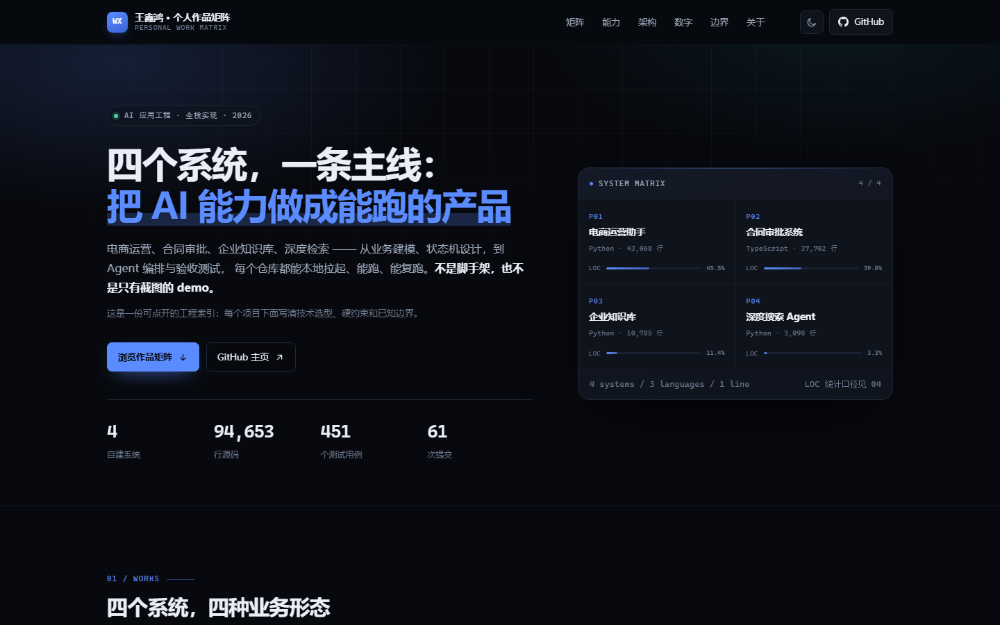

# 王鑫鸿 · 个人作品矩阵

四个系统，一条主线：把 AI 能力做成能跑的产品。

**在线访问**：https://xinhongwang138-hue.github.io/WangXinhong-Personal-Work-Matrix/

这是一个静态单页站点，把这四个仓库收进一页可复核的索引 —— 技术选型、硬约束、测试用例、已知边界都写在对应卡片里。



---

## 一、这里放的是什么

不是简历，是**工程索引**。判断标准只有三条：

1. 每个项目都能在本地从零拉起（迁移、种子、启动脚本齐备）；
2. 每个数字都有统计口径，能自己跑一遍复算；
3. 跑不动的部分直接写「未跑通 + 原因」，不用 mock 假装通过。

页面分八节：作品矩阵 → 界面演示 → 能力矩阵 → 架构主线 → 可复核的数字 → 已知边界 → 关于 → 联系。

「关于」节开头有一条**求职状态条**（当前状态 / 目标岗位 / 到岗时间 / 联系方式），与首屏 eyebrow 同源；「工作方式」四条原则下面挂了三个站内锚点，指向架构主线、可复核的数字与已知边界 —— 主张要能点进去核对，不空转。

## 二、四个项目

| 编号 | 项目 | 仓库 | 主栈 | 源码行数 | 测试用例 |
| --- | --- | --- | --- | --- | --- |
| P01 | 电商运营助手 | [ecommerce-operation-assistant](https://github.com/xinhongwang138-hue/ecommerce-operation-assistant) | Next.js 16 · FastAPI · Celery · LangGraph | 43,068 | 181 |
| P02 | 合同审批系统 | [contract-approval](https://github.com/xinhongwang138-hue/contract-approval) | Next.js 16.4 · Prisma 7 · PostgreSQL 16 | 37,702 | 259 |
| P03 | 企业知识库 | [knowledge_base](https://github.com/xinhongwang138-hue/knowledge_base) | LangGraph · Milvus · BGE-M3 · MinerU | 10,785 | 未建套件 |
| P04 | 深度搜索 Agent | [deep-search-agent](https://github.com/xinhongwang138-hue/deep-search-agent) | DeepAgents · FastAPI · WebSocket · Vue 3 | 3,098 | 11 |

合计 94,653 行源码、574 个源码文件、451 个测试用例、61 次提交。统计口径与复算命令见 [docs/VERIFY.md](docs/VERIFY.md)。

## 三、本地查看

零依赖，任意静态服务器都能跑：

```bash
python -m http.server 8910
# 打开 http://127.0.0.1:8910/
```

也可以直接双击 `index.html`（相对路径引用，file:// 下同样可用）。

### 复现 02 节的四张实拍截图

| 系统 | 怎么起 | 截图地址 |
| --- | --- | --- |
| P01 电商运营助手 | 本地 `npm run dev` | `http://127.0.0.1:3000/ask` |
| P02 合同审批 | clone 仓库 → `npm ci` → `npx prisma generate` → `next dev -p 3001`（需先起 Postgres，端口 5432） | `http://127.0.0.1:3001/contracts` |
| P03 企业知识库 | `docker compose` 起导入与查询两个 API，先把文档 POST 到 `/upload` | `http://127.0.0.1:8011/chat.html` |
| P04 深度搜索 | `docker compose -f docker-compose.demo.yml up -d`（自带种子库）→ `python main.py` → `ui/` 下 `npm run dev` | `http://127.0.0.1:5173/` |

P02 与 P04 都需要一份 `.env`：数据库连接串、模型网关与 Key。两处细节：

- 截图前把 Next 的开发浮标（`nextjs-portal`）藏掉，否则左下角会多一个红色 Issue 徽标；
- P02 的应用内置了 `.dark` 变量集（shadcn 默认）但没挂 ThemeProvider，默认浅色。
  截图时给 `<html>` 加一个 `dark` 类即可切到深色，与另外三张的色调统一 —— 用的是应用自带的样式，
  不是后期改图。

## 四、部署

站点为纯静态资源，默认从 `main` 分支根目录发布 GitHub Pages：

1. Settings → Pages → Source 选 `Deploy from a branch`；
2. Branch 选 `main` / `root`；
3. 访问 `https://xinhongwang138-hue.github.io/WangXinhong-Personal-Work-Matrix/`。

`.nojekyll` 已存在，避免 Jekyll 处理以 `_` 开头的文件。

## 五、目录结构

```
.
├─ index.html              单页站点（全部内容与文案）
├─ assets/
│  ├─ css/tokens.css       设计令牌：颜色 / 字体 / 间距 / 圆角 / 动效
│  ├─ css/app.css          页面样式（含响应式与减动效适配）
│  ├─ js/app.js            主题切换 / 菜单 / 滚动监听 / 数字滚动
│  └─ img/                 图标、OG 分享图、演示截图（demo-p01 ~ p04）
├─ docs/
│  ├─ VERIFY.md            数字的统计口径与复算命令
│  ├─ count_loc.py         行数 / 文件数 / 用例数的统计脚本
│  └─ preview.png          README 预览图
├─ robots.txt              允许抓取 + 指向 sitemap
├─ sitemap.xml             单页 sitemap
├─ .nojekyll
└─ README.md
```

## 六、维护约定

- **改数字要同步三处**：首屏统计条、05 节的四张卡、项目卡底部的小字。改完跑一遍 `docs/VERIFY.md` 的脚本。
- **不写没有证据的数字**：没有并发压测就不写 QPS / P95，没有覆盖率报告就不写覆盖率。
- **站内不放手机号、邮箱、简历文件**：联系方式统一走 GitHub。
- **新增项目**：在 01 节加一张卡，在 03 节补一行能力，同时更新总行数与用例总数 —— 三处不一致就是 bug。
- **链路图的节点只能来自仓库事实**：图里出现的每一格（工作台 / 队列 / 编排 / 存储）都要能在对应仓库的 README 或代码里找到，不用「大概是这样」的画法。
- **演示图分「实拍」和「示意图」两种，不许混**：实拍必须是本地实例的真实截图（地址条保留当时的地址）；起不来的（缺 Key、缺依赖、源码不在本机）只能画线框示意图，地址条标「非真实截图」。两者不能互换。目前四套都能在本机跑起来，02 节四张全是实拍。
- **示意图要照前端源码画**：分区、面板顺序、字段名都从组件里读，不按印象画。P02、P04 的两版线框都因为跟实际界面对不上被推翻重画过，最后两张也换成了实拍。
- **等宽数字里的千分位逗号单独包 `.num-sep`**：等宽字体中逗号独占一个全角槽位，数字串看起来像多打了空格。逗号改用比例宽度字体渲染，数字本身仍保持等宽对齐。字体选 `Helvetica Neue / Helvetica / Arial / Liberation Sans` 这一族 —— Helvetica 与 Arial 的逗号 advance 同为 278/1000 em，Liberation Sans 与 Arial 度量兼容，三平台观感一致。**不要用负 margin 收紧等宽逗号**：实测 Consolas 在 −0.08em 时左侧间隙即归零（粘连），通用 `monospace` 同样如此，跨平台不安全。

## 七、兼容与降级

这一节记录的是实测过的行为，不是愿望：

- **无 JS**：入场动效的初始隐藏挂在 `html.js` 上，脚本没跑内容也照常可见（搜索引擎抓取同理）。
- **打印 / 另存为 PDF**：深色主题会把设计令牌整体换成浅底深字，卡片按 `break-inside: avoid` 分页；统计数字在 `beforeprint` 时直接落到终值，避免把滚动动画中间的数字印出去。
- **对比度**：正文与辅助文字在明暗两套主题下均 ≥ 4.5:1；9–10.5px 的小字已统一上调到 11–12px。
- **键盘与读屏**：`skip-link`、可见焦点环、当前区块用 `aria-current="location"` 标记，链路图整块给 `aria-label` 描述。

## 八、已知边界

1. 没有可交互的在线 demo：四套系统依赖本地数据库或向量库，仓库给的是可复现的启动路径。02 节四张实拍来自本机实例（3000 / 3001 / 5173 / 8011），按 1440×900 视口直接截屏，没有后期修图。
2. P03 只有 1 个链路脚本，没有 pytest 套件与断言，回归靠人眼看节点输出。
3. LLM Key、Milvus 集群、RAGFlow、Tavily 不随仓库分发，缺依赖时链路明确失败。
4. 未做并发压测与覆盖率统计。
5. 没有 CI 流水线：四个仓库都靠本地脚本跑测试，没有配置自动校验。
6. 本页面做了键盘可达与减动效适配，但未做完整 WCAG 审计。

---

王鑫鸿
